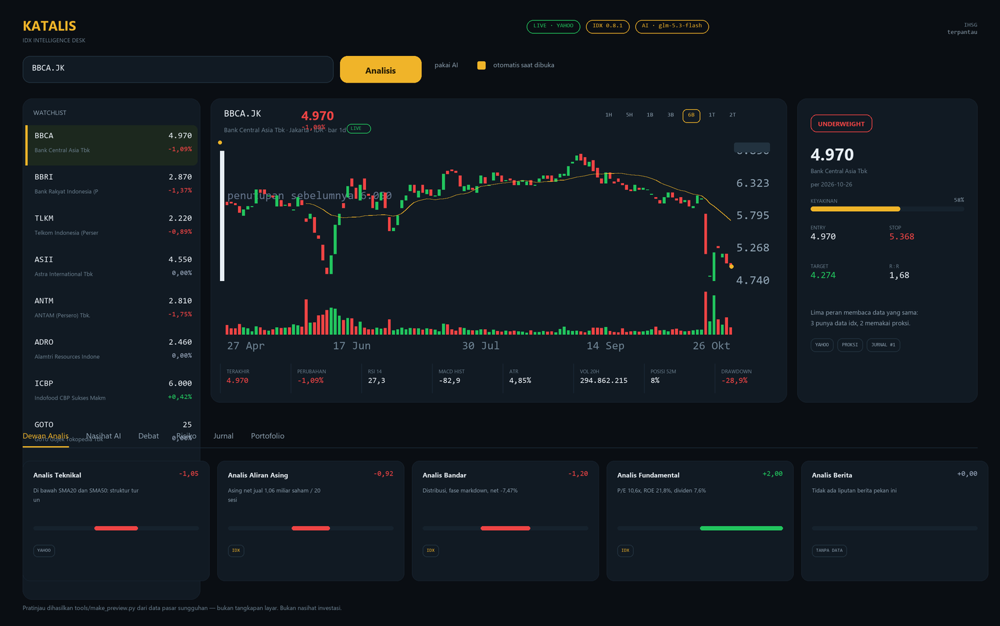

# KATALIS

[](LICENSE)
[](https://www.python.org/)
[](#jalankan)
[](https://github.com/adri-cry/KATALIS/actions/workflows/ci.yml)

**IDX Intelligence Desk** — satu meja untuk membaca saham Indonesia: harga, aliran dana,
bandarmologi, dan dewan analis yang menghasilkan satu rating.



> *Pratinjau di atas dibuat oleh `tools/make_preview.py` dari data pasar sungguhan melalui
> `renderCandles()` milik aplikasi — bukan tangkapan layar. Jalankan sendiri untuk melihat
> versi interaktifnya.*

Program ini menggabungkan dua proyek sumber terbuka:

| Sumber | Yang diambil |
|---|---|
| [TauricResearch/TradingAgents](https://github.com/TauricResearch/TradingAgents) (Apache-2.0) | Pola kerja sebuah kantor riset: laporan analis → debat bull/bear → manajer riset → trader dengan level harga → tiga sikap risiko → satu rating lima tingkat. Plus dua gagasan yang paling berguna: **jurnal keputusan** dan **penilaian terhadap benchmark**. |
| [fzn0x/idx](https://github.com/fzn0x/idx) (MIT) | Kedalaman data pasar Indonesia: aliran asing, akumulasi broker (bandar), pemilik saham KSEI, dividen, aksi korporasi, kalender bursa. |

Keduanya **tidak** disimpan di repo ini (ukurannya beberapa megabita dan lisensinya
milik proyek masing-masing); ambil kapan saja dengan `node tools/fetch_repos.mjs`
lalu `python tools/extract_repos.py`. Mesin KATALIS sendiri ditulis ulang secara
mandiri dan **tidak butuh paket pihak ketiga**. Tanpa kunci API pun seluruh mesin
berjalan; dengan `OPENAI_API_KEY`, lapisan AI menambahkan tesis dan risiko di atas
angka yang sama.

---

## Jalankan

Syarat: **Python 3.10+** (diuji pada 3.14.4). Tidak ada `pip install`, tidak ada `npm install`.

**Windows:** klik dua kali `run.bat`. Skrip itu mencari interpreter yang benar-benar
hidup, menampilkan path yang dipakai, lalu mencetak alamat dashboard.

**Linux/macOS:**

```bash
cd katalis
./run.sh
```

**Cara manual:** `py app.py` di Windows, `python3 app.py` di Linux/macOS.

Buka **http://127.0.0.1:8770**.

### Kalau muncul "Python was not found" padahal Python sudah terpasang

Itu bukan tanda Python belum ada — itu **App Execution Alias** Microsoft Store.
Windows menaruh stub bernama `python.exe` di
`%LOCALAPPDATA%\Microsoft\WindowsApps\` yang menangkap perintah `python` dan hanya
menampilkan pesan itu, walaupun Python asli ada di entri PATH berikutnya (gejalanya:
`python -c "exit"` mengembalikan kode **9009**).

`run.bat` sudah menangani ini: setiap kandidat **diuji dengan benar-benar menjalankannya**,
dan stub yang gagal dilewati. Kalau Anda memanggil `python` langsung, pilih satu:

| Cara | Langkah |
|---|---|
| Launcher resmi | `py app.py` |
| Matikan alias | Settings → Apps → Advanced app settings → App execution aliases → matikan `python.exe` dan `python3.exe` |
| Pasang ulang | python.org, centang "Add python.exe to PATH" |

`run.bat` mencetak interpreter mana yang dipakai di baris kedua, jadi Anda bisa melihat
apakah ia memilih Python yang benar.

Di balik layar, saat halaman dibuka program akan:

1. mengambil harga harian dari Yahoo Finance (gratis, tanpa kunci),
2. menghitung indikator (SMA, RSI, MACD, ATR, Bollinger, MFI, OBV, drawdown),
3. **menunggu Anda menekan Analisis** — di situlah lima peran berjalan dan, bila
   dicentang, satu panggilan model dilakukan,
4. mencatat keputusan ke jurnal untuk dinilai beberapa hari kemudian.

### Kapan analisis berjalan

Membuka atau me-refresh halaman **tidak** menjalankan analisis. Yang dimuat otomatis
hanya harga, watchlist, dan IHSG — semuanya gratis.

| Aksi | Yang terjadi | Biaya |
|---|---|---|
| Buka / refresh halaman | harga, chart, watchlist | gratis |
| Klik saham di watchlist atau tombol cepat | chart saham itu | gratis |
| Tekan **Analisis** | lima peran + satu panggilan model bila dicentang | gratis bila **pakai AI** dimatikan |
| Centang **otomatis saat dibuka** | analisis ikut berjalan saat halaman dibuka | satu panggilan per buka |

Dua centangan di bawah kotak pencarian tersimpan di browser:

- **pakai AI** — matikan untuk menjalankan dewan analis tanpa model sama sekali.
- **otomatis saat dibuka** — mati secara default, supaya refresh tidak menagih.

---

## Yang terlihat di dashboard

| Bagian | Isi |
|---|---|
| **Watchlist** (kiri) | Harga, perubahan, dan kilasan 30 sesi untuk tiap saham. Klik = pilih saham (tanpa biaya). Harga yang bergerak berkedip dan diperbarui tiap 30 detik. |
| **Grafik** (tengah) | Lilin + SMA20 + volume, sumbu waktu, garis penutupan sebelumnya, dan penanda harga terakhir yang berdenyut. **Arahkan kursor ke lilin** untuk membaca O/H/L/C, volume, perubahan, dan harga pada posisi kursor. Rentang: **1H / 5H** (intraday) sampai 2 tahun. Harga di judul bergerak mengikuti stream. |
| **Ringkasan keputusan** | Label Beli/Tunggu/Hindari dipetakan secara deterministik dari rating mesin; bila data kurang, timeframe tak selaras, atau arah sinyal berbeda, sistem memilih Tunggu/Data belum cukup. Bukan probabilitas atau nasihat investasi. |
| **Kartu putusan** (kanan) | Rating lima tingkat, skor keyakinan heuristik (bukan peluang profit), serta level mesin: entry, stop, target, R:R, jumlah lot, dan nilai rupiah. Rating AI tampil terpisah. |
| **Nasihat AI** | Tesis, alasan dan risiko model; Entry/Stop/Target tetap level mesin. AI tidak menetapkan atau mengubah level. |
| **Simulasi** | Skenario P/L kotor/neto dari level mesin, jumlah lot dan modal yang Anda masukkan; biaya opsional hanya bila tarif broker Anda diketahui. Tidak memasukkan slippage/pajak yang tak diisi. |
| **Dewan Analis** | Lima kartu peran: skor −2…+2, bukti yang mendukung dan yang menentang, plus label sumber (`data idx` atau `proksi`). |
| **Debat** | Argumen terkuat di kedua sisi, diambil dari bukti peran. |
| **Risiko** | Tiga sikap: agresif, netral, konservatif — masing-masing dengan angka yang mendasarinya. |
| **Jurnal** | Setiap keputusan, alasan yang disimpan saat itu, rating mesin/AI, harga masuk/keluar, return, IHSG, dan **alpha**. Tombol untuk menilai yang sudah jatuh tempo; ini evaluasi maju, bukan backtest. |
| **Portofolio** | Posisi, harga rata-rata, laba/rugi, kas, dan ekuitas. Ekuitas inilah yang dipakai menghitung ukuran posisi. |

### Realtime

| Yang diperbarui | Jalur | Irama |
|---|---|---|
| Harga saham aktif (judul chart, lilin terakhir, baris watchlist) | **SSE** `GET /api/stream?symbol=` | tiap **5 detik** |
| Seluruh watchlist (8 kartu) | `GET /api/watchlist` | tiap **30 detik** |
| IHSG di kanan atas | `GET /api/benchmark` | tiap **60 detik** |
| Umur data di chart | dihitung di browser | tiap **1 detik** |

Cache server juga dipersingkat: jendela **1H** 10 detik, **1B** 30 detik, **6B** 2 menit
(dulu satu jendela 6 bulan di-cache 15 menit, jadi harga bisa tertinggal seperempat jam).
Tombol **⟳** memaksa muat ulang tanpa menunggu cache.

Stream ini hanya menghubungi Yahoo, **tidak memanggil model** — membuka dashboard
tidak menambah biaya AI. Bila koneksi putus, browser menyambung ulang sendiri dan
label `LIVE` berubah menjadi `terputus`.

---

## Bagaimana rating dibuat

Lima peran membaca snapshot yang sama. Masing-masing memberi skor −2…+2:

| Peran | Bobot | Membaca |
|---|---|---|
| Analis Teknikal | 34% | Tren (harga vs SMA20/50/200), RSI, MACD, Bollinger, volume |
| Analis Aliran Dana | 20% | OBV, rasio volume hari naik/turun — atau aliran asing bila biner `idx` ada |
| Analis Bandar | 20% | MFI, OBV pada posisi rentang 52 minggu — atau bandarmologi `idx` |
| Analis Fundamental | 16% | P/E, ROE, dividen — **butuh `idx`** |
| Analis Berita | 10% | Sentimen berita Kontan/CNBC — **butuh `idx`** |

Setiap skor peran dinormalkan dulu ke rentang −2…+2 menurut jumlah maksimum suku yang bisa
dicapai peran tersebut, sehingga peran dengan banyak suku dan sedikit suku tetap sebanding —
dan rating tidak berubah hanya karena `idx` tidak ada dan sebuah peran berpindah ke proksi.
Skor digabung dengan bobot, lalu dipetakan ke skala lima tingkat:

```
≥ +0,9  Buy          +0,3 … +0,9  Overweight     −0,3 … +0,3  Hold
−0,9 … −0,3  Underweight          ≤ −0,9  Sell
```

Bobot dinormalkan ulang bila sebuah peran tidak punya data, dan kartunya diberi label
**tanpa data** — kekosongan tidak pernah dilaporkan sebagai "netral".

Mesin ini **deterministik**: snapshot yang sama selalu menghasilkan rating yang sama.
Itu penting, karena tanpa sifat itu catatan kinerja di jurnal tidak berarti apa-apa.

---

## Kenapa ada jurnal, dan apa itu alpha

Rating tanpa catatan hasil hanyalah pendapat. Karena itu setiap analisis dicatat, lalu
dinilai setelah jendela 5 sesi bursa terlewati:

- **Masuk** di harga tutup **sesudah** tanggal keputusan (berita yang dibaca siang hari
  baru bisa ditransaksikan besoknya),
- **Keluar** di tutup sesi ke-5,
- **Alpha** = return saham − return **IHSG** pada tanggal yang sama.

Alpha positif berarti keputusan itu mengalahkan pasar, bukan sekadar ikut naik.
Rating `Hold` tidak mengklaim arah, jadi ia tidak diberi angka "tepat" — supaya tidak
mendapat kemenangan gratis.

---

## Membuka data khusus IDX (opsional)

Tanpa biner `idx`, peran aliran dana dan bandar memakai proksi dari harga dan volume,
dan peran fundamental serta berita tampil **tanpa data**. Untuk data sungguhan (aliran
asing per sesi, akumulasi broker, P/E, dividen, sentimen berita), ada dua jalan.

### Jalan 1 — unduh biner siap pakai (disarankan, tanpa compile)

Setiap rilis `idx` menerbitkan biner per platform. Tidak perlu Rust, tidak perlu Visual
Studio. Ambil `idx-<versi>-x86_64-pc-windows-msvc.zip` dari
[halaman rilis](https://github.com/fzn0x/idx/releases), verifikasi checksum-nya, lalu
letakkan `idx.exe` di:

```
katalis/vendor/idx/bin/idx.exe
```

KATALIS menemukannya otomatis saat dijalankan. Di Linux/macOS, pakai
`*-unknown-linux-musl.tar.gz` atau `*-apple-darwin.tar.gz` dan simpan sebagai
`vendor/idx/bin/idx`.

### Jalan 1b — skrip yang sudah disiapkan

```bash
node tools/fetch_idx_binary.mjs     # unduh + verifikasi SHA256 ke repos/
```

Lalu ekstrak isinya ke `vendor/idx/bin/` (zip-nya berisi `idx.exe`, `README.md`,
`CHANGELOG.md`, `LICENSE`).

### Jalan 2 — bangun dari sumber

```bash
cd vendor/idx
cargo build --release
```

Ini **butuh linker MSVC**. Bila muncul:

```
error: linker `link.exe` not found
note: the msvc targets depend on the msvc linker but `link.exe` was not found
```

mesin Anda belum punya Visual Studio Build Tools — dan VS Code bukan penggantinya.
Pilihannya: pasang **Build Tools for Visual Studio** dengan komponen "Desktop development
with C++" (beberapa GB), atau kembali ke Jalan 1 yang tidak butuh apa pun. Ada juga target
GNU (`x86_64-pc-windows-gnu`) yang butuh MinGW, tetapi dua jalur pertama lebih singkat.

### Setelah binernya ada

```bash
IDX_BIN=/path/ke/idx python app.py      # bila tidak di vendor/idx/bin/
```

Kartu peran akan berlabel **data idx**, dan chip di kanan atas menampilkan versinya.
Endpoint `/api/idx?cmd=bandar&symbol=BBCA.JK` juga terbuka untuk data mentahnya
(`bandar`, `foreign`, `fundamental`, `profile`, `dividends`, `actions`, `news`, `holidays`).

**Catatan soal penolakan sesekali.** Sebagian endpoint `idx` mengambil data dari
`idx.co.id`, yang menolak sebagian permintaan secara acak (perilaku ini didokumentasikan
proyek aslinya). KATALIS mencoba ulang sekali; bila tetap gagal, peran itu jatuh ke proksi
dan **menuliskan alasannya** di kartu peran — bukan diam-diam menjadi netral.

---

## Lapisan AI (OpenAI)

Mesin KATALIS menghitung; model bahasa menafsirkan. Pemisahan ini disengaja: angka,
indikator, aliran dana, dan rating mekanis tetap dihitung tanpa AI — dan itulah yang
dinilai jurnal. AI menambahkan tesis, daftar risiko, dan syarat yang membatalkan tesis.

### Mengaktifkan

1. Salin `.env.example` menjadi `.env`.
2. Isi `OPENAI_API_KEY`.
3. Jalankan ulang `python app.py`.

Chip di kanan atas berubah dari `AI · mati` menjadi `AI · gpt-4o-mini`. Bisa juga lewat
variabel lingkungan: `OPENAI_API_KEY=... python app.py`.

| Variabel | Guna | Default |
|---|---|---|
| `OPENAI_API_KEY` | kunci; tanpa ini lapisan AI mati | — |
| `OPENAI_MODEL` | model yang dipanggil | `gpt-4o-mini` |
| `OPENAI_BASE_URL` | endpoint lain yang kompatibel (gateway/proksi) | `https://api.openai.com/v1` |

### Apa yang dikirim ke model

Ringkasan numerik saja: harga, indikator, skor dan argumen tiap peran, rencana mekanis,
benchmark, dan portofolio bila Anda mengisinya. Tidak ada kunci, tidak ada berkas, tidak
ada riwayat percakapan. Bila portofolio masih kosong, tidak ada data posisi yang keluar.

### Apa yang dijanjikan, dan apa yang tidak

- Model **dilarang mengarang angka**: prompt menyatakan bukti yang dikirim sebagai
  satu-satunya sumber, dan data yang tidak tersedia harus disebut sebagai ketiadaan.
- Rating AI **boleh berbeda** dari rating mesin. Perbedaannya ditampilkan
  ("beda: mesin Hold"), disimpan di jurnal, dan **dinilai terpisah** setelah jatuh tempo —
  jadi Anda bisa membandingkan mana yang lebih baik, bukan menebak.
- Bila kunci salah, kuota habis, atau jawabannya bukan JSON, lapisan AI **gagal dengan
  pesan jelas** dan rating mesin tetap dipakai. Tidak ada angka karangan sebagai pengganti.

### Biaya

Satu analisis = satu panggilan model. Terukur pada `glm-5.3-flash` lewat gateway:
**±4.500 token** (prompt sistem ±800, bukti numerik ±3.000, jawaban ±700). Tarifnya
mengikuti gateway masing-masing — hitung dari angka token di respons (`usage`) bila ingin
tahu persisnya. Turunkan biaya dengan `--analysts` yang lebih sedikit? Tidak berlaku di
sini; yang bisa ditekan adalah panjang `range` (bar yang dikirim ke UI tidak ikut ke model,
jadi biaya praktis tetap).

---

## Pemindai: saham mana yang layak dibeli

Dashboard menganalisis **satu** saham yang Anda pilih. Pemindai menjawab pertanyaan
sebaliknya: dari sebuah daftar saham, mana yang layak dibeli sekarang.

```bash
cp universe.example.txt data/universe.txt     # lalu ganti isinya dengan LQ45/IDX30 terbaru
python -m core.screener                       # universe, jika kosong watchlist
python -m core.screener BBCA BBRI TLKM --no-ai
python -m core.screener --top 3 --record      # catat pilihan ke jurnal agar dinilai vs IHSG
```

Lewat HTTP: `POST /api/screen` dengan `{"symbols": [...], "max_picks": 5, "ai": true, "record": false}`.

Tiga tahap, yang murah lebih dulu — satu permintaan harga per saham, analisis penuh
hanya untuk shortlist, dan **satu** panggilan model untuk semuanya:

| Tahap | Dikerjakan | Yang ditolak |
|---|---|---|
| 1. Gerbang | kode | nilai transaksi harian < Rp1 miliar, harga < Rp100, ATR > 7%, riwayat < 120 sesi, data terakhir > 7 hari lalu, lalu skor teknikal ≤ 0. Sisanya diurutkan; `shortlist` teratas (default 15) lanjut |
| 2. Dewan | kode (`desk.analyse`) | rating mesin di bawah Overweight |
| 3. Model | satu panggilan | kandidat yang diturunkan model ke Hold atau lebih rendah; model boleh mengembalikan **nol** pilihan |

Batas gerbang ada di `Gate` (`core/screener.py`). Setiap saham yang ditolak tercatat
beserta tahap dan alasannya (`rejected`), dan saham yang gagal diambil masuk `errors` —
tidak ada yang hilang diam-diam.

Aturan yang dijaga kode, bukan hanya prompt:

- Model hanya menilai kandidat yang ia terima; kode saham karangan dibuang dan dilaporkan.
- Hanya rating Buy/Overweight dari model yang bisa jadi pilihan, dan jumlahnya dibatasi `max_picks`.
- **Entry, stop, dan target selalu dari mesin**; model tidak pernah memberi level harga.
- Bila model mati atau gagal, pilihan jatuh ke urutan mesin dan `picks_source` berubah
  dari `model` menjadi `mesin`, dengan alasannya di `ai.error`.
- Dengan `--record`, hanya pilihan yang dicatat, dan vonis model disimpan di kolom AI
  jurnal — jadi mesin vs model dinilai terpisah, sama seperti analisis biasa.

Batas yang perlu diketahui:

- Shortlist diurutkan menurut **skor teknikal** (cocok untuk horizon 5 sesi di jurnal).
  Saham dengan fundamental bagus tetapi tren lemah tidak akan lolos; naikkan `--shortlist`
  atau ubah sendiri tahap 1 bila horizon Anda lebih panjang.
- Status UMA, suspensi, dan papan pemantauan khusus **tidak terbaca** dari data harga.
  Periksa sendiri di idx.co.id sebelum membeli.
- Tanpa biner `idx`, kandidat hanya bertumpu pada proksi harga/volume, dan itu
  ditandai di `flags` serta diberitahukan ke model agar keyakinannya turun.
- Yahoo membatasi permintaan beruntun; universe 40 saham wajar memakan beberapa puluh detik.

---

## API

| Endpoint | Guna |
|---|---|
| `POST /api/screen` | `{"symbols": [], "max_picks": 5, "shortlist": 15, "ai": null, "record": false}` → kandidat, pilihan, saham yang ditolak beserta alasannya |
| `GET /api/health` | Versi, benchmark, status `idx`, ringkasan jurnal |
| `GET /api/watchlist` / `POST` | Daftar + harga; `{"add": ["ANTM.JK"]}` atau `{"remove": "..."}` |
| `GET /api/market?symbol=&range=` | Bar OHLCV + indikator |
| `POST /api/analyze` | `{"symbol": "BBCA.JK", "holding_days": 5}` → seluruh hasil dewan + ringkasan keputusan berbasis aturan |
| `POST /api/simulate` | Simulasi P/L memakai level mesin pada analisis terkini; modal, lot, biaya opsional dari pengguna |
| `GET /api/journal` / `POST /api/settle` | Catatan keputusan + alasan/level tersimpan; nilai yang jatuh tempo |
| `GET/POST /api/portfolio`, `POST /api/cash` | Posisi, kas, ekuitas |
| `GET /api/idx?cmd=&symbol=` | Data mentah dari biner `idx` |

Kode saham boleh ditulis pendek: `BBCA` otomatis menjadi `BBCA.JK`.

---

## Batas yang perlu diketahui

- **Bukan nasihat investasi.** Mesin ini membaca aturan yang ditulis manusia; ia tidak
  tahu berita hari ini, tidak membaca laporan keuangan, dan tidak mengenal manajemen.
- **Tanpa autentikasi.** Server hanya melayani komputer ini (`127.0.0.1`). Siapa pun yang
  memakai mesin yang sama dapat memicu analisis — dan bila lapisan AI aktif, itu berarti
  memakai kuota model Anda.
- **Harga tertunda.** Yahoo Finance tidak real-time. Untuk eksekusi, gunakan data broker Anda.
- **Tidak ada analisis historis.** Semua perhitungan memakai data terbaru; jurnal menilai
  ke depan, bukan menguji masa lalu. Backtest butuh arsip data yang belum ada di sini.
- **Peran fundamental dan berita kosong tanpa `idx`.** Itu keterbatasan yang disengaja
  dan ditampilkan apa adanya, bukan bug.
- **Ukuran posisi memakai asumsi**: risiko 1% ekuitas per ide, dibatasi 10% ekuitas,
  dibulatkan ke lot 100 saham dan tick harga IDX. Selama portofolio masih kosong, ukuran
  posisi ditampilkan "—" dan tidak ditebak.
- **Satu keputusan per saham per hari.** Analisis ulang di hari yang sama memperbarui
  tampilan, tetapi tidak menimpa catatan jurnal — supaya rekam jejak tidak berubah surut
  setelah hasilnya diketahui.
- **Opini AI pertama hari itu yang disimpan.** Analisis ulang tetap menampilkan pendapat
  terbaru di kartu, tapi jurnal tidak menimpanya; baris yang belum punya opini AI masih
  bisa diisi sekali.
- **AI bisa salah, dan bisa terdengar lebih yakin daripada datanya.** Ia hanya membaca
  ringkasan yang dikirim; bila sebuah peran tidak punya data, model diminta menyebutnya
  sebagai ketiadaan. Tetap periksa angkanya sendiri.
- **Lapisan AI bukan penasihat berlisensi.** Disclaimer selalu ditampilkan di tab
  Nasihat AI; jangan menghapusnya bila program ini dipakai orang lain.

---

## Struktur

```
katalis/
  app.py                 server HTTP + API + penyaji dashboard (hanya pustaka standar)
  core/
    market.py            Yahoo Finance, cache, indikator, tick realtime
    desk.py              lima peran, debat, manajer, trader, risiko, rating
    journal.py           pencatatan dan penilaian terhadap IHSG
    store.py             SQLite: watchlist, keputusan, portofolio
    idxbridge.py         jembatan opsional ke biner idx
    llm.py               klien OpenAI (hanya pustaka standar)
    advisor.py           prompt + validasi jawaban model; level harga selalu dari mesin
    guidance.py          pemetaan Beli/Tunggu/Hindari, konflik, freshness, dan risiko
    simulation.py        skenario P/L dari level mesin + input pengguna
    screener.py          pemindai: gerbang kode -> dewan -> satu panggilan model
  web/
    index.html app.js styles.css    dashboard (tanpa framework, tanpa build)
  tools/
    check_ui.mjs         render dashboard terhadap data sungguhan
    test_pure.py         backend/offline: keputusan, konflik, simulasi, jurnal, pemindai
    test_pure.mjs        frontend/offline: ringkasan, simulator, chart, dan escape
    check_crosshair.js   geometri crosshair tanpa browser
    fetch_repos.mjs      unduh sumber kedua repo ke vendor/
    extract_repos.py     bongkar arsip itu ke susunan yang dipakai
    fetch_idx_binary.mjs unduh biner idx siap pakai + verifikasi SHA256
    stub_openai.mjs      tiruan endpoint OpenAI untuk menguji tanpa biaya
  vendor/                sumber pihak ketiga — TIDAK ikut repo, ambil sendiri
  data/                  katalis.db + cache harga (dibuat saat dijalankan)
```

### Yang sengaja tidak masuk repo

| Berkas | Alasan |
|---|---|
| `.env` | berisi kunci API Anda — ada di `.gitignore` |
| `data/` | basis data jurnal, portofolio, dan cache harga milik Anda |
| `vendor/` | sumber TradingAgents dan idx; ~5 MB dan lisensinya milik proyek asing |

Ambil kembali sumber pihak ketiga kapan saja:

```bash
node tools/fetch_repos.mjs      # unduh kedua repo ke vendor/
node tools/fetch_idx_binary.mjs # opsional: biner idx siap pakai
python tools/extract_repos.py   # bongkar keduanya ke susunan yang dipakai
```

Tanpa langkah itu KATALIS tetap berjalan: peran aliran dana dan bandar memakai
proksi harga, dan kartunya berlabel `proksi`.

## Uji

Dua rangkaian offline — tanpa jaringan, tanpa kunci API — dijalankan CI pada setiap push:

```bash
python tools/test_pure.py        # 103 cek backend: indikator, dewan, jurnal, pemindai
node tools/test_pure.mjs         # 46 cek frontend: ringkasan, simulator, chart, escape
```

Satu pemeriksaan manual, karena memakai analisis sungguhan dari Yahoo Finance:

```bash
python app.py                    # terminal 1
node tools/check_ui.mjs          # terminal 2 — 42 pemeriksaan render (36 tanpa AI)
```

`check_ui.mjs` memeriksa SVG grafik, lima kartu peran, penandaan sumber, dua kolom debat,
tiga sikap risiko, konsistensi id HTML↔JS, jurnal, dan portofolio. Ia sengaja tidak masuk
CI: hasilnya bergantung pada jaringan. `CHECK_AI=1` hanya untuk `tools/stub_openai.mjs`,
jangan untuk akun berbayar.

## Kredit & lisensi

KATALIS dirilis di bawah **MIT License** ([LICENSE](LICENSE)). Kredit untuk TradingAgents
(Apache-2.0) dan idx (MIT), beserta daftar sumber data, ada di
[ATTRIBUTION.md](ATTRIBUTION.md) — berkas terpisah supaya GitHub mengenali lisensi repo ini
sebagai MIT, bukan "Other".

KATALIS adalah karya turunan dari pola dan gagasan kedua proyek di atas; kode aslinya
berada utuh di `vendor/`. TradingAgents berlisensi Apache-2.0, idx berlisensi MIT —
sertakan pemberitahuan masing-masing bila Anda menyebarkan ulang. Data pasar milik
sumbernya masing-masing (Yahoo Finance, IDX, KSEI, IPOT, Kontan, CNBC) dan tunduk pada
ketentuan mereka, bukan pada lisensi kode ini.
